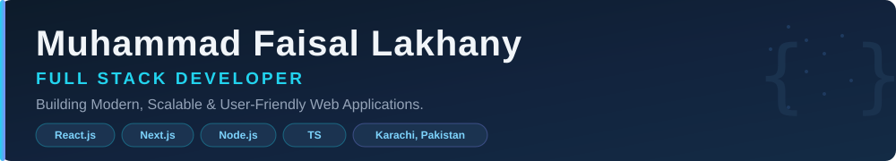

<!-- ============================================================
     Muhammad Faisal Lakhany — Full Stack Developer
     GitHub Profile README
     ============================================================ -->

  

---

## 1 · Hero / Introduction

# Muhammad Faisal Lakhany

### Full Stack Developer

**Building Modern, Scalable & User-Friendly Web Applications.**

[GitHub](https://github.com/faisalrlakhany) · Karachi, Pakistan · React.js · Next.js · Node.js

---

## 2 · About Me

Hi, I'm **Muhammad Faisal Lakhany** — a passionate **Full Stack Developer** focused on building modern, responsive, scalable, and user-friendly web applications.

I enjoy transforming ideas into functional digital products by combining modern frontend technologies with backend development, database management, and API integrations.

I focus on writing clean code, creating attractive interfaces, solving problems, and continuously improving my development skills.

**My interests include:**

- Full Stack Web Development
- Modern Frontend Development
- Backend API Development
- Responsive UI/UX Design
- Database Management
- Web Application Development
- Third-Party API Integration

---

## 3 · Professional Highlights

|  | Highlight |
|---|---|
| **Full Stack Development** | Built end-to-end web applications — React frontends, Node.js APIs, and Firebase / MongoDB / MySQL data layers |
| **Backend & APIs** | Developed REST APIs with Node.js & Express and integrated third-party services (weather, Google Sheets, email) |
| **Authentication & Security** | Implemented authentication and authorization flows using Firebase and MongoDB |
| **Responsive UI/UX** | Delivered mobile-first, cross-browser compatible interfaces with Tailwind CSS and Bootstrap |

---

## 4 · Technical Skills

**Frontend** — HTML5 · CSS3 · JavaScript · TypeScript · React.js · Next.js · Bootstrap · Tailwind CSS

**Backend** — Node.js · Express.js · REST API Development · API Integration & Handling

**Database** — Firebase · MySQL

**Tools** — Git · GitHub · VS Code · Postman · npm

**Additional Skills** — Responsive Web Design · Frontend & Backend Development · Authentication & Authorization · Database Integration · Website Optimization · Component-Based Architecture · Cross-Browser Compatibility · Debugging & Troubleshooting · Third-Party API Integration

---

## 5 · Technology Stack

### Frontend

  

### Backend

  

### Tools & Platforms

  

---

## 6 · Featured Projects

> Links below point to real repositories and live deployments only. Projects without a link are guided projects under development / being published.

### 1 · Attendance Management Portal

Multi-institute attendance management platform with separate Admin, Teacher, and Student panels, attendance tracking, and monthly summaries.

`HTML` `CSS` `JavaScript` `Firebase`

### 2 · Fruit Website — FreshHarvest

Fruit and grocery website with product-focused layouts.

### 3 · Food Website — Burger Restaurant

Restaurant and food website with attractive food presentation and menu sections.

### 4 · Calculator Application

Interactive calculator application with calculation functionality and history.

`React Native` `TypeScript` `Expo`

### 5 · Gym Website

Modern fitness and gym website with responsive design and professional sections.

`HTML` `CSS` `JavaScript` `Responsive Design`

### 6 · Digital Agency Website

Professional agency website presenting services, business solutions, and company information.

`HTML` `CSS` `JavaScript` `Responsive Design`

### 7 · Car Wash Website

Car wash service website showcasing available services and business information.

`HTML` `CSS` `JavaScript` `Responsive Design`

### 8 · Salon Website

Modern salon website with beauty services and elegant presentation.

`HTML` `CSS` `JavaScript` `Responsive Design`

### 9 · Coffee Website

Coffee shop website with stylish design and product presentation.

`HTML` `CSS` `JavaScript` `Responsive Design`

---

### More From My Work

| Project | Tech | Links |
|---------|------|-------|
| **Blogging App** | React · Firebase | [Repo](https://github.com/faisalrlakhany/Blogging-App) · [Live](https://blogging-app-rouge-eight.vercel.app) |
| **Todo App — MongoDB** | Node.js · Express · MongoDB | [Repo](https://github.com/faisalrlakhany/TodoApp-MongoDB) |
| **Auth Using MongoDB** | Node.js · MongoDB · JWT | [Repo](https://github.com/faisalrlakhany/Auth-using-MongoDb) |
| **Weather App (React)** | React · Weather API | [Repo](https://github.com/faisalrlakhany/WeatherApp) · [Live](https://weather-app-react-umber-xi.vercel.app) |
| **Quote Generator** | JavaScript · API | [Repo](https://github.com/faisalrlakhany/QuoteGenerator) · [Live](https://quote-generator-bay-iota.vercel.app) |
| **Quiz App** | React · JavaScript | [Repo](https://github.com/faisalrlakhany/QuizApp) · [Live](https://quiz-app-react-theta-ten.vercel.app) |

---

## 7 · What I'm Currently Working On

- Expanding my **Next.js** and **TypeScript** skill set with production-level projects
- Building and publishing the **Attendance Management Portal** (Admin / Teacher / Student panels)
- Strengthening backend fundamentals: **Express.js REST APIs**, **MySQL** schema design, and **authentication flows**
- Contributing to and maintaining my open repositories with cleaner commits and documentation

---

## 8 · GitHub Statistics

  

---

## 9 · Top Languages

  

### GitHub Streak

  

---

## 10 · Contribution Activity Graph

  

---

## 11 · Connect With Me

---

## Footer

<em>Open to Full Stack Developer roles, freelance work, and collaborations.</em>

