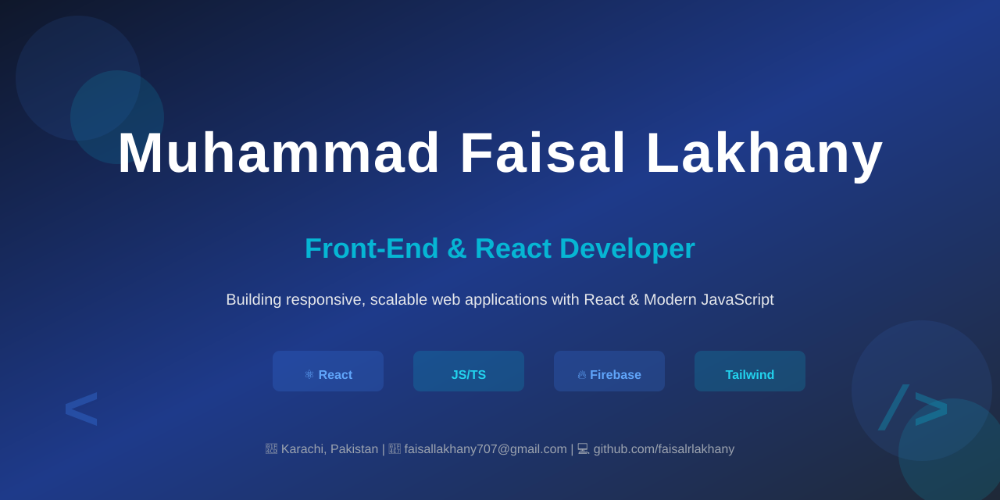

<!-- GitHub Profile Banner -->

  

<h1 align="center">Hi there, I'm Muhammad Faisal Lakhany 👋</h1>

  <strong>Front-End & React Developer</strong> 💻  
  📍 Karachi, Pakistan | 📞 +92 322 1039098 | ✉️ faisallakhany707@gmail.com  
  🔗 <a href="https://github.com/faisalrlakhany">GitHub Profile</a>

  🚀 Passionate about building responsive and user-friendly web applications  
  💡 Skilled in modern JavaScript technologies including React.js, Firebase, and TypeScript  
  📚 Always learning and committed to writing clean, maintainable code  

---

---

## 👤 Professional Summary
Passionate Front-End and React Developer with hands-on experience in building responsive and user-friendly web applications. Skilled in modern JavaScript technologies including React.js, Firebase, TypeScript, Tailwind CSS, and Bootstrap. Experienced in developing real-world projects and committed to writing clean, maintainable code while continuously learning new technologies.

---

## 🛠 Technical Skills ⚙️
- **Frontend:** HTML5, CSS3, JavaScript (ES6+), TypeScript, React.js, jQuery
- **Styling:** Tailwind CSS, Bootstrap, Material UI (MUI)
- **Backend:** Basic Node.js, REST API Integration
- **Database & Services:** Firebase, Basic React Native
- **Tools:** Git & GitHub, Responsive Web Design
- **Other:** Problem Solving, Team Collaboration

  
  
  
  
  
  
  
  
  
  

---

## 🚀 Projects

### 📊 Attendance Management System
- **Technologies:** HTML, CSS, JavaScript, Firebase
- Developed a web-based attendance management system with real-time data storage and management
- Implemented Firebase for reliable backend services

### 🏋️ Gym Website
- **Technologies:** HTML, CSS, JavaScript
- Designed and developed a responsive gym website with a modern user interface
- Focused on user experience and mobile responsiveness

### 🍎 Fruit Website
- **Technologies:** HTML, CSS, JavaScript
- Built a responsive fruit store website with attractive layouts and interactive sections

---

## 💼 Professional Experience

### Front-End Developer – Travel Website Project
- Developed responsive user interfaces using modern front-end technologies
- Collaborated with the development team to deliver a smooth user experience
- Optimized performance and ensured cross-browser compatibility

### Front-End Developer – eSIM Website Project
- Designed and implemented responsive web pages
- Optimized UI components for performance and cross-browser compatibility
- Maintained high code quality and best practices

---

## 🎓 Education

### Bachelor of Science in Computer Science (BSCS) – In Progress
**Dawood University of Engineering & Technology**
- Currently: 2nd Year

### Intermediate (Computer Science) – 2024
**Islamia Science College, Karachi**
- Grade: B

### Matriculation (Computer Science) – 2022
**Mama Baby Care School**
- Grade: A+

### Dars-e-Nizami (In Progress)
- Completed: 4 years of a 6-year Islamic Education program

---

## 📜 Certifications
- **Web & App Development** – Saylani Mass IT Training (SMIT)

---

## 🌐 Languages
- **Urdu** - Native
- **English** - Intermediate

---

## 🎯 Career Objective
Seeking a Front-End Developer or React Developer position where I can apply my technical skills, contribute to innovative projects, and continue growing as a software developer while delivering high-quality web applications.

---

## 🔗 Connect With Me
📞 **Phone:** +92 322 1039098  
✉️ **Email:** faisallakhany707@gmail.com  
💼 **GitHub:** [github.com/faisalrlakhany](https://github.com/faisalrlakhany)  
📍 **Location:** Karachi, Pakistan

Feel free to reach out for **collaborations, freelance projects, or just to say hi!** 😊  
